# **Agent 4: Data Flow Diagrams and Interactions**

---

## **Document Information**
- **Version**: 1.0
- **Author**: Vibe Code (Mistral AI)
- **Date**: 2025
- **Purpose**: Visual representation of data flows, interactions, and architecture
- **Format**: Text-based diagrams (Mermaid syntax) for compatibility

---

## **Table of Contents**
1. [Architecture Diagrams](#architecture-diagrams)
2. [Data Flow Diagrams](#data-flow-diagrams)
3. [Sequence Diagrams](#sequence-diagrams)
4. [Component Interaction Diagrams](#component-interaction-diagrams)
5. [State Diagrams](#state-diagrams)
6. [Class Diagrams](#class-diagrams)
7. [File Dependency Diagrams](#file-dependency-diagrams)

---

## **Architecture Diagrams**

### **1. System Architecture Overview**

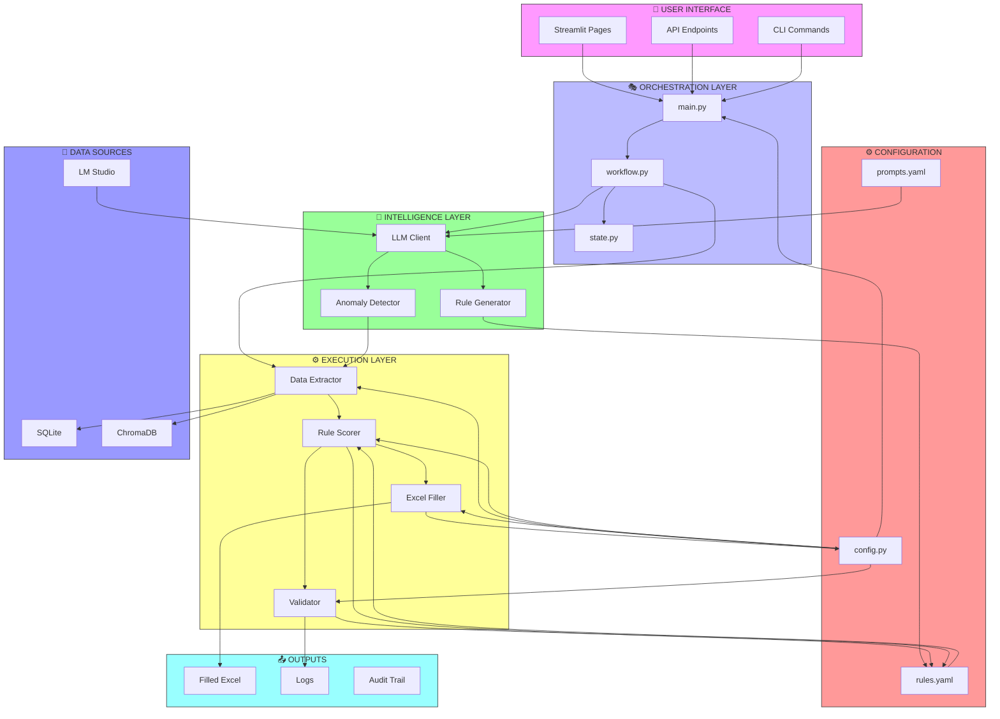

---

### **2. Layered Architecture**

```mermaid
graph LR
    %% Layered Architecture
    
    subgraph L1["Layer 1: User Interface"]
        A1[Streamlit]
        A2[FastAPI]
        A3[CLI]
    end
    
    subgraph L2["Layer 2: Orchestration"]
        B1[LangGraph Workflow]
        B2[State Management]
    end
    
    subgraph L3["Layer 3: Intelligence"]
        C1[LLM Client]
        C2[Rule Generator]
        C3[Anomaly Detector]
    end
    
    subgraph L4["Layer 4: Execution"]
        D1[Data Extractor]
        D2[Rule Scorer]
        D3[Excel Filler]
        D4[Validator]
    end
    
    subgraph L5["Layer 5: Data"]
        E1[SQLite]
        E2[ChromaDB]
        E3[Configuration Files]
    end
    
    L1 --> L2
    L2 --> L3
    L3 --> L4
    L4 --> L5
    
    style L1 fill:#ff9999,stroke:#333
    style L2 fill:#99ff99,stroke:#333
    style L3 fill:#9999ff,stroke:#333
    style L4 fill:#ff99ff,stroke:#333
    style L5 fill:#ffff99,stroke:#333
```

---

### **3. Integration with Existing Pipeline**

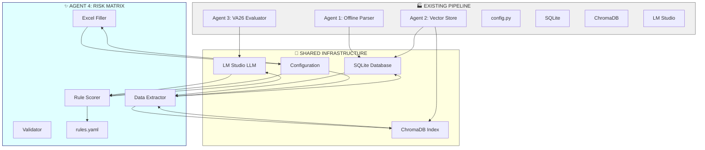

---

## **Data Flow Diagrams**

### **1. End-to-End Data Flow**

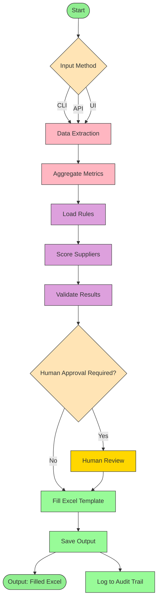

---

### **2. Data Extraction Flow**

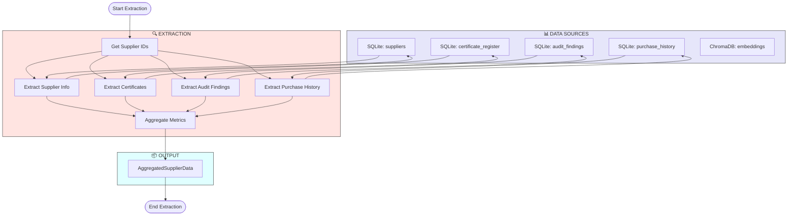

---

### **3. Scoring Flow**

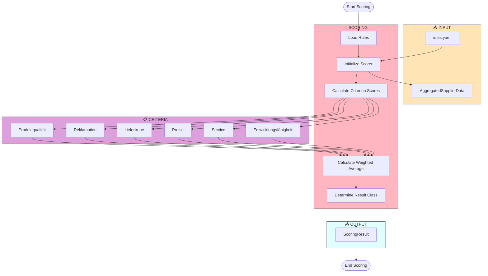

---

### **4. Excel Filling Flow**

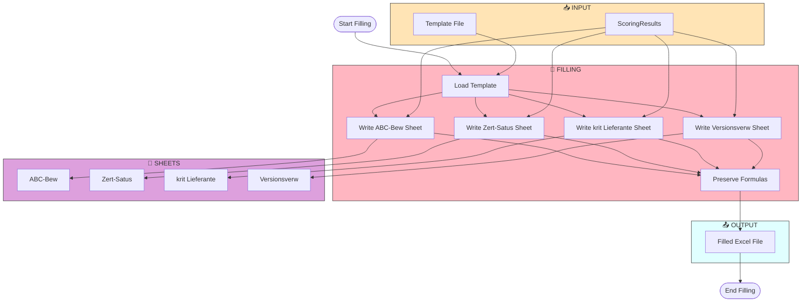

---

## **Sequence Diagrams**

### **1. Main Workflow Sequence**

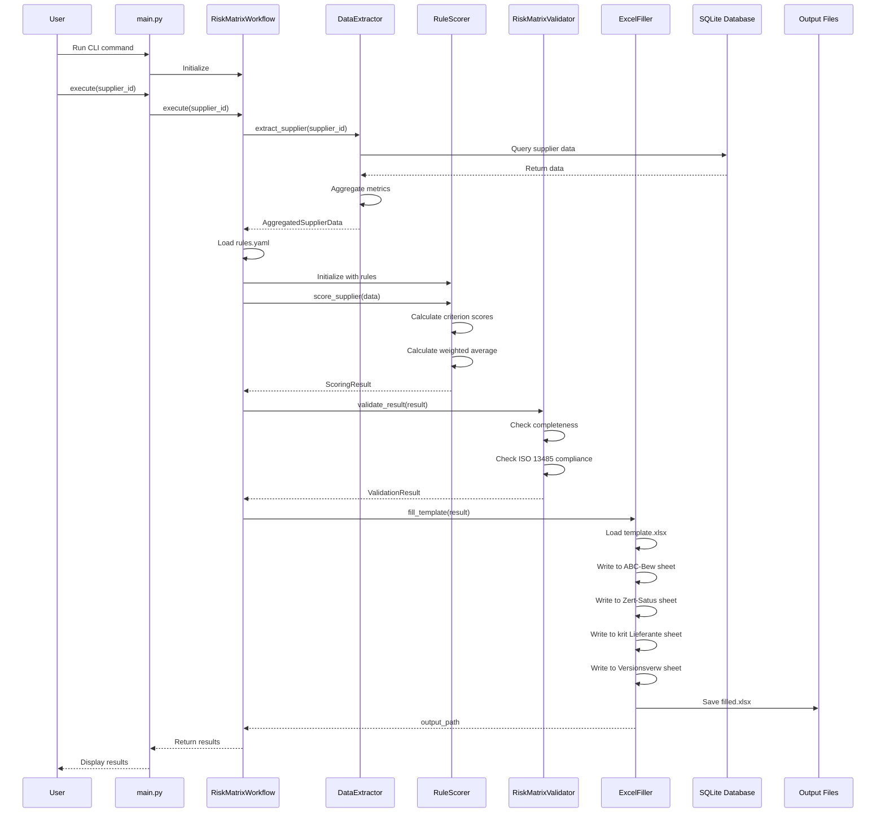

---

### **2. LLM Rule Generation Sequence**

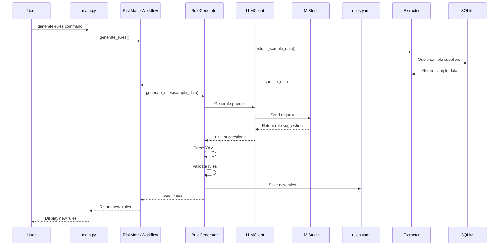

---

### **3. Anomaly Detection Sequence**

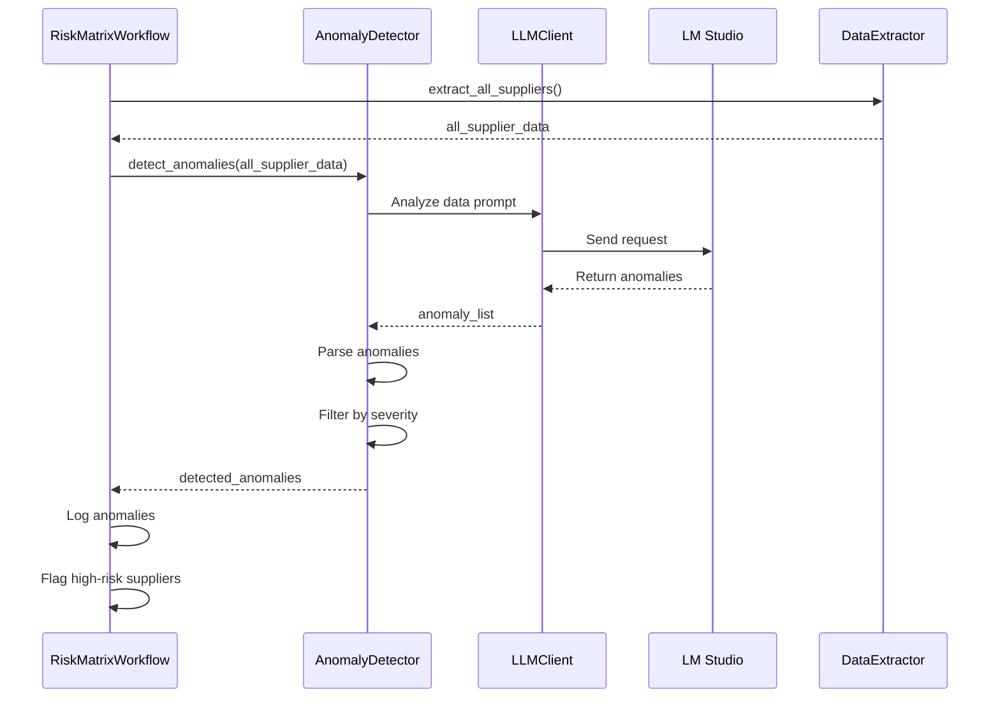

---

## **Component Interaction Diagrams**

### **1. Orchestrator Component Interactions**

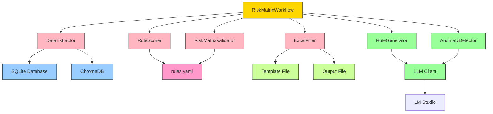

---

### **2. Data Layer Interactions**

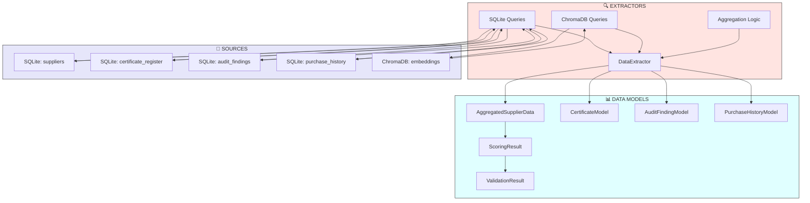

---

### **3. Execution Layer Interactions**

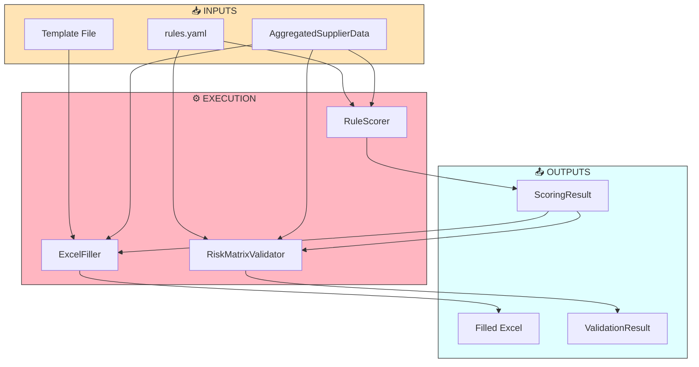

---

## **State Diagrams**

### **1. Workflow State Machine**

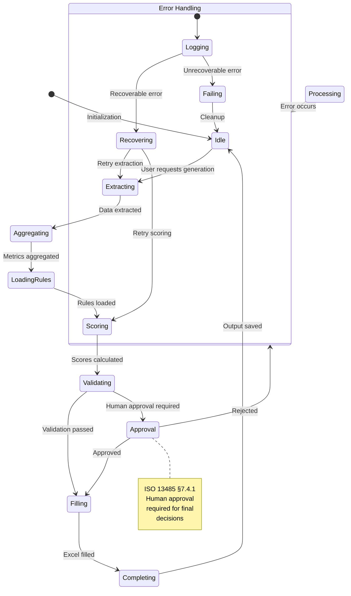

---

### **2. Supplier Processing State**

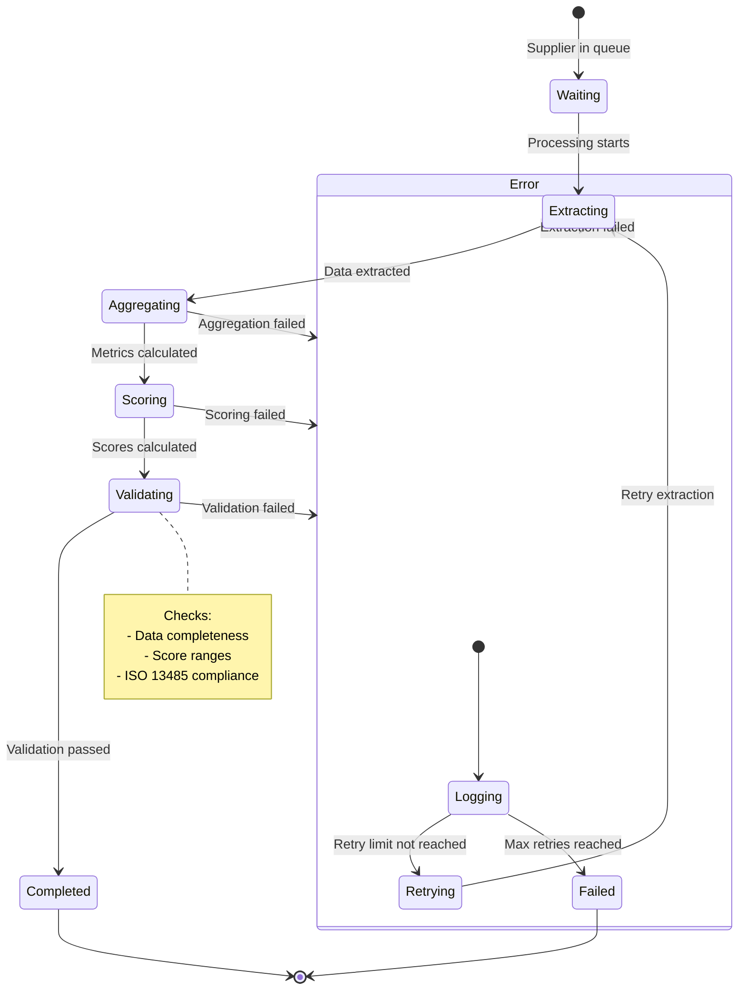

---

## **Class Diagrams**

### **1. Core Classes**

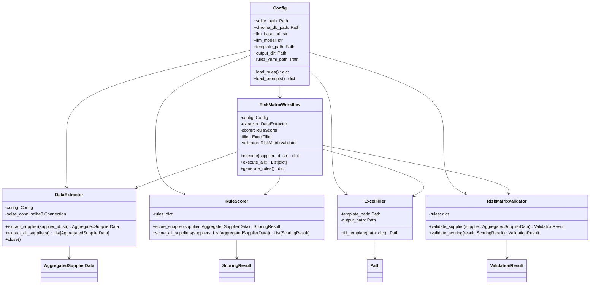

---

### **2. Data Model Classes**

```mermaid
classDiagram
    %% Data Model Classes
    
    class AggregatedSupplierData {
        +supplier_id: str
        +legal_name: str
        +short_name: Optional[str]
        +certificate: Optional[CertificateModel]
        +certificates: List[CertificateModel]
        +audit_findings: List[AuditFindingModel]
        +purchase_history: List[PurchaseHistoryModel]
        +total_orders: int
        +total_value: float
        +quality_score: Optional[float]
        +complaint_rate: Optional[float]
        +on_time_delivery_rate: Optional[float]
        +price_variance: Optional[float]
        +service_score: Optional[float]
        +development_score: Optional[float]
        +consecutive_delays: int
    }
    
    class CertificateModel {
        +certificate_type: str
        +certificate_number: Optional[str]
        +issue_date: Optional[date]
        +expiry_date: Optional[date]
        +issuing_body: Optional[str]
        +is_expiring_soon(threshold_days: int) bool
    }
    
    class AuditFindingModel {
        +finding_id: str
        +supplier_id: str
        +audit_date: date
        +severity: str
        +category: str
        +description: str
        +score: Optional[float]
        +quality_score: Optional[float]
        +complaint_count: Optional[int]
        +consecutive_delays: Optional[int]
    }
    
    class PurchaseHistoryModel {
        +purchase_id: str
        +supplier_id: str
        +order_date: date
        +delivery_date: Optional[date]
        +promised_delivery_date: date
        +unit_price: float
        +quantity: int
        +total_value: float
        +on_time: bool
        +delay_days: Optional[int]
    }
    
    class ScoringResult {
        +supplier_id: str
        +legal_name: str
        +criteria_scores: Dict[str, CriterionScore]
        +weighted_sum: float
        +total_weight: float
        +weighted_average: float
        +result_class: ResultClass
        +scored_at: datetime
        +rules_version: str
        +anomalies: List[dict]
        +is_critical: bool
        +critical_reason: Optional[str]
    }
    
    class CriterionScore {
        +criterion: str
        +raw_score: Optional[float]
        +normalized_score: float
        +weight: float
        +weighted_score: float
        +threshold: str
    }
    
    class ValidationResult {
        +supplier_id: str
        +is_valid: bool
        +errors: List[str]
        +warnings: List[str]
        +completeness: float
        +iso_13485_compliant: bool
        +requires_human_approval: bool
    }
    
    ResultClass "1" --> "A"
    ResultClass "2" --> "B"
    ResultClass "3" --> "C"
    
    AggregatedSupplierData "1" *-- "1..*" CertificateModel
    AggregatedSupplierData "1" *-- "1..*" AuditFindingModel
    AggregatedSupplierData "1" *-- "1..*" PurchaseHistoryModel
    ScoringResult "1" *-- "1" AggregatedSupplierData
    ScoringResult "1" *-- "1..*" CriterionScore
    ScoringResult "1" *-- "0..*" ValidationResult
```

---

### **3. LLM Classes**

```mermaid
classDiagram
    %% LLM Classes
    
    class LLMClient {
        -config: Config
        -client: httpx.Client
        -model: str
        +generate(prompt: str, system_prompt: Optional[str]) str
        +chat(messages: List[dict]) str
    }
    
    class RuleGenerator {
        -llm: LLMClient
        +generate_rules(supplier_data: List[AggregatedSupplierData]) dict
        +optimize_rules(current_rules: dict, data: List[AggregatedSupplierData]) dict
        +suggest_improvements(rules: dict) List[str]
    }
    
    class AnomalyDetector {
        -llm: LLMClient
        +detect_anomalies(supplier_data: List[AggregatedSupplierData]) List[Anomaly]
        +analyze_trends(supplier_data: List[AggregatedSupplierData]) List[Trend]
        +flag_high_risk(supplier_data: AggregatedSupplierData) bool
    }
    
    class Anomaly {
        +supplier_id: str
        +anomaly_type: str
        +severity: Severity
        +details: str
        +recommendation: Optional[str]
    }
    
    Severity "1" --> "Low"
    Severity "2" --> "Medium"
    Severity "3" --> "High"
    Severity "4" --> "Critical"
    
    LLMClient --> RuleGenerator
    LLMClient --> AnomalyDetector
    RuleGenerator --> AnomalyDetector
```

---

## **File Dependency Diagrams**

### **1. Agent 4 File Dependencies**

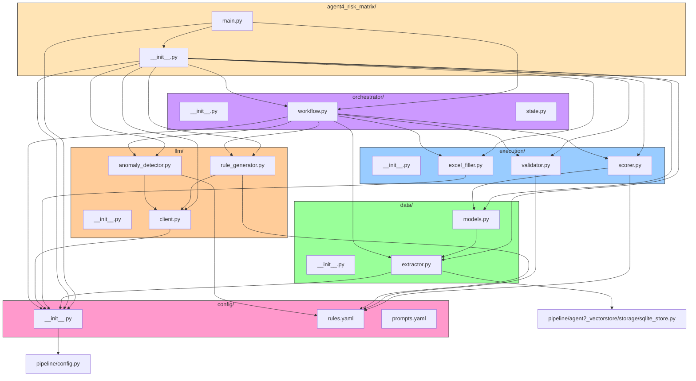

---

### **2. Integration Dependencies**

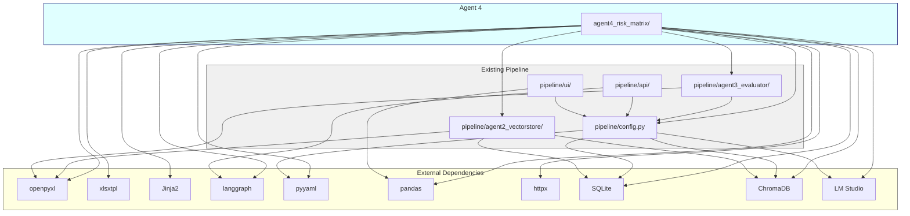

---

## **Summary**

This document provides **comprehensive visual documentation** of Agent 4's architecture, data flows, and interactions through:

### **📊 Architecture Diagrams**
- System architecture overview
- Layered architecture
- Integration with existing pipeline

### **📈 Data Flow Diagrams**
- End-to-end data flow
- Data extraction flow
- Scoring flow
- Excel filling flow

### **📽️ Sequence Diagrams**
- Main workflow sequence
- LLM rule generation sequence
- Anomaly detection sequence

### **🔗 Component Interaction Diagrams**
- Orchestrator component interactions
- Data layer interactions
- Execution layer interactions

### **🔄 State Diagrams**
- Workflow state machine
- Supplier processing state

### **🏗️ Class Diagrams**
- Core classes
- Data model classes
- LLM classes

### **📁 File Dependency Diagrams**
- Agent 4 file dependencies
- Integration dependencies

These diagrams **complement the textual documentation** and provide a **visual understanding** of how the system works.

---

## **How to Use These Diagrams**

1. **For Understanding Architecture**: Start with the architecture diagrams
2. **For Debugging**: Use the data flow and sequence diagrams
3. **For Development**: Reference the class and component interaction diagrams
4. **For Integration**: Use the file dependency diagrams
5. **For Documentation**: Include relevant diagrams in other documents

---

## **Mermaid Syntax Reference**

All diagrams in this document use **Mermaid syntax**, which is:
- **Compatible** with many documentation tools (GitHub, GitLab, VS Code, etc.)
- **Text-based** for easy version control
- **Readable** in plain text
- **Renderable** in Markdown viewers that support Mermaid

---

*Document Version: 1.0 | Author: Vibe Code (Mistral AI)*
