# Flow Diagrams: Agent 4 Implementation

## 1. Overview

This document provides **visual flow diagrams** for Agent 4 using Mermaid syntax. These diagrams illustrate:
- System architecture
- Data flow
- Component interactions
- Workflow sequences
- State transitions

---

## 2. System Architecture Diagram

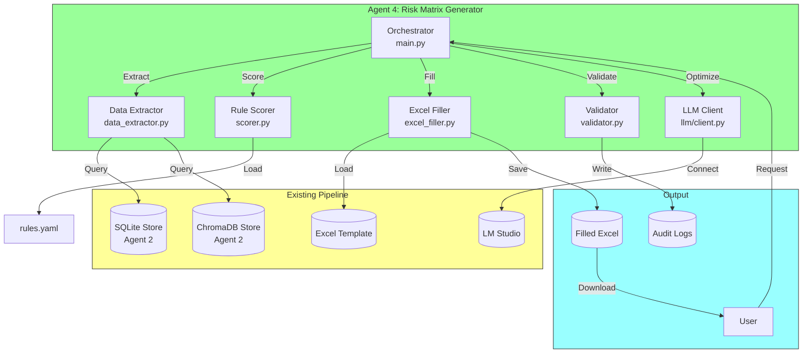

---

## 3. Data Flow Diagram

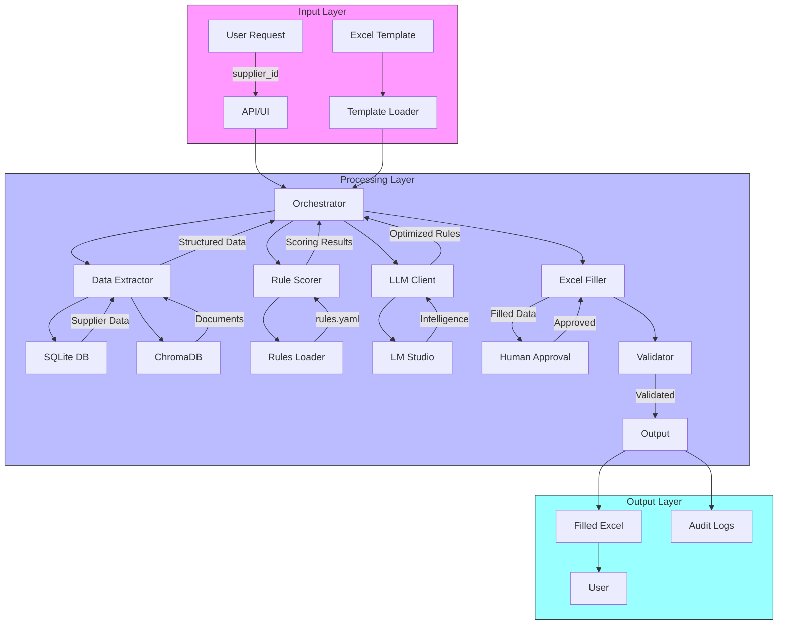

---

## 4. Workflow Sequence Diagram

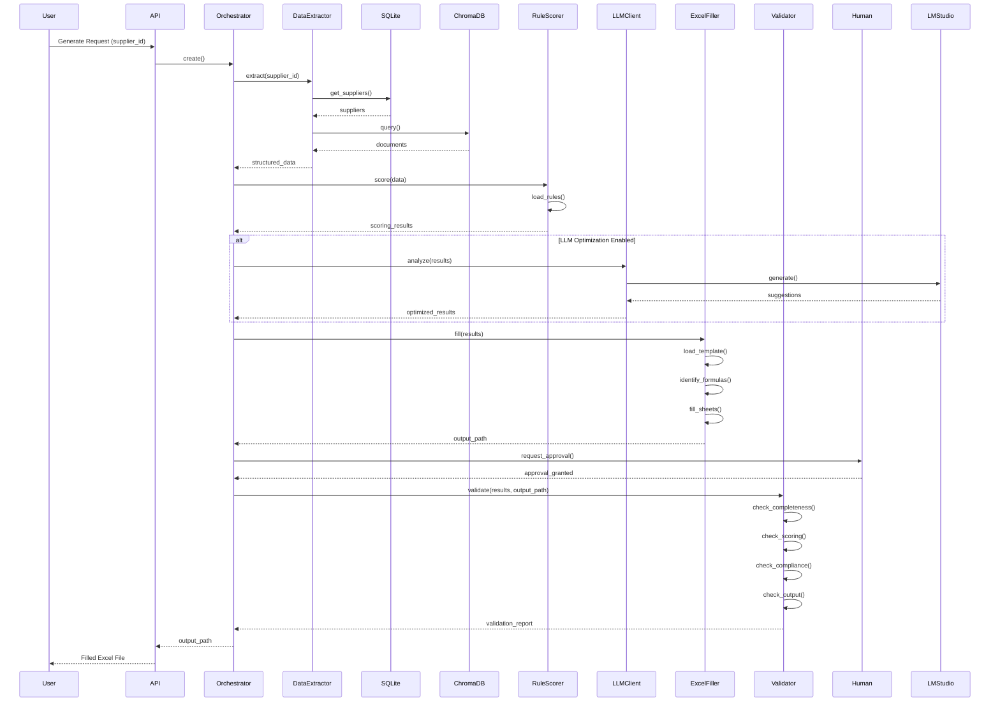

---

## 5. Component Interaction Diagram

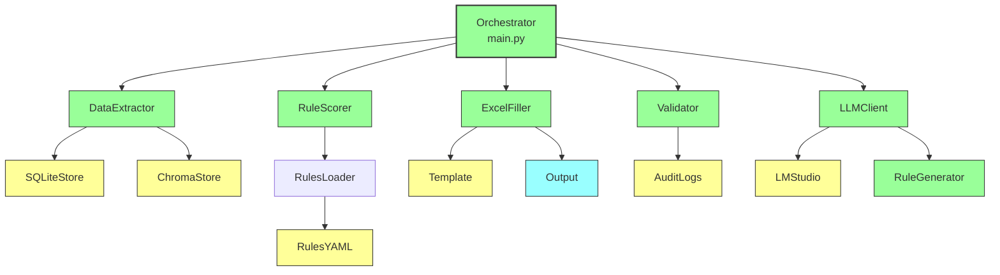

---

## 6. Excel Filling Process Diagram

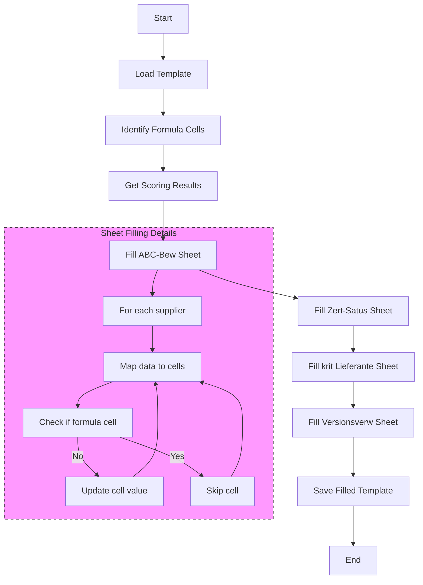

---

## 7. Data Transformation Diagram

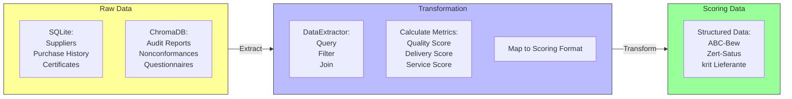

---

## 8. Scoring Process Diagram

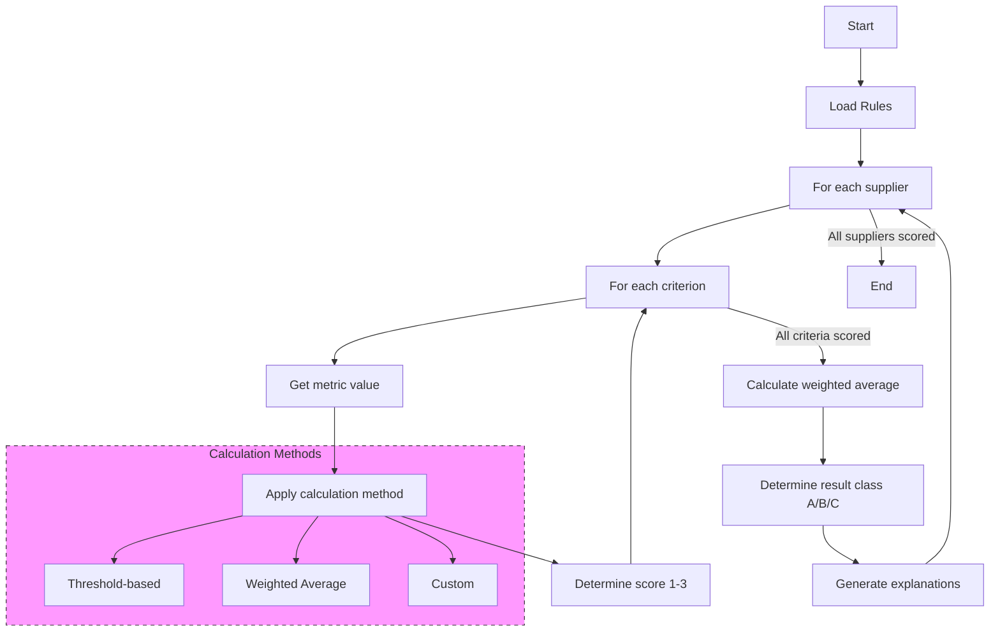

---

## 9. Validation Process Diagram

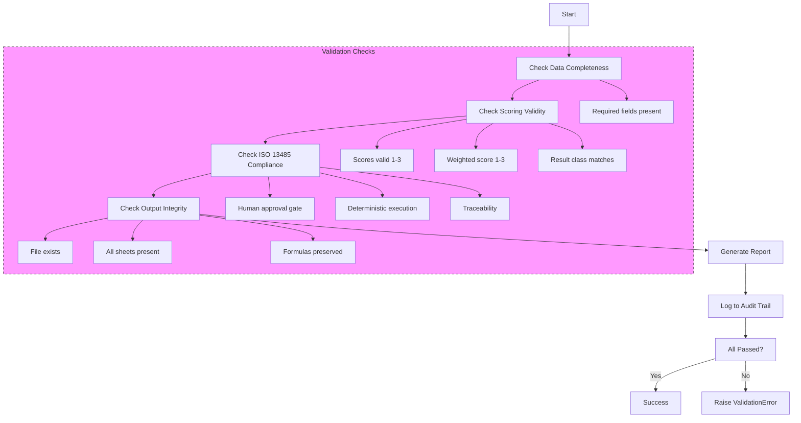

---

## 10. LLM Integration Diagram

```mermaid
flowchart TD
    A[Start] --> B[User Request]
    B --> C[Orchestrator decides:\nUse LLM?]
    C -->|No| D[Skip LLM]
    C -->|Yes| E[LLMClient.generate()]
    E --> F[Send prompt to LM Studio]
    F --> G[Receive response]
    G --> H[Parse response]
    H --> I[Validate suggestions]
    I --> J[Apply approved changes]
    J --> K[Return optimized results]
    
    subgraph LLM[LLM Operations]
        E --> E1[Rule Generation]
        E --> E2[Rule Optimization]
        E --> E3[Anomaly Detection]
        E --> E4[Explanation Generation]
    end
    
    style LLM fill:#f9f,stroke:#333,stroke-dasharray: 5 5
```

---

## 11. ISO 13485 Compliance Diagram

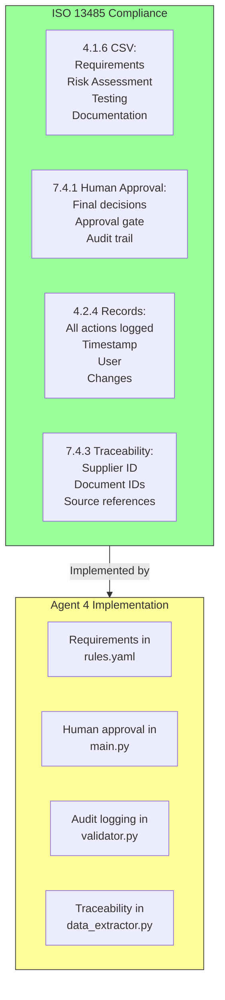

---

## 12. Error Handling Diagram

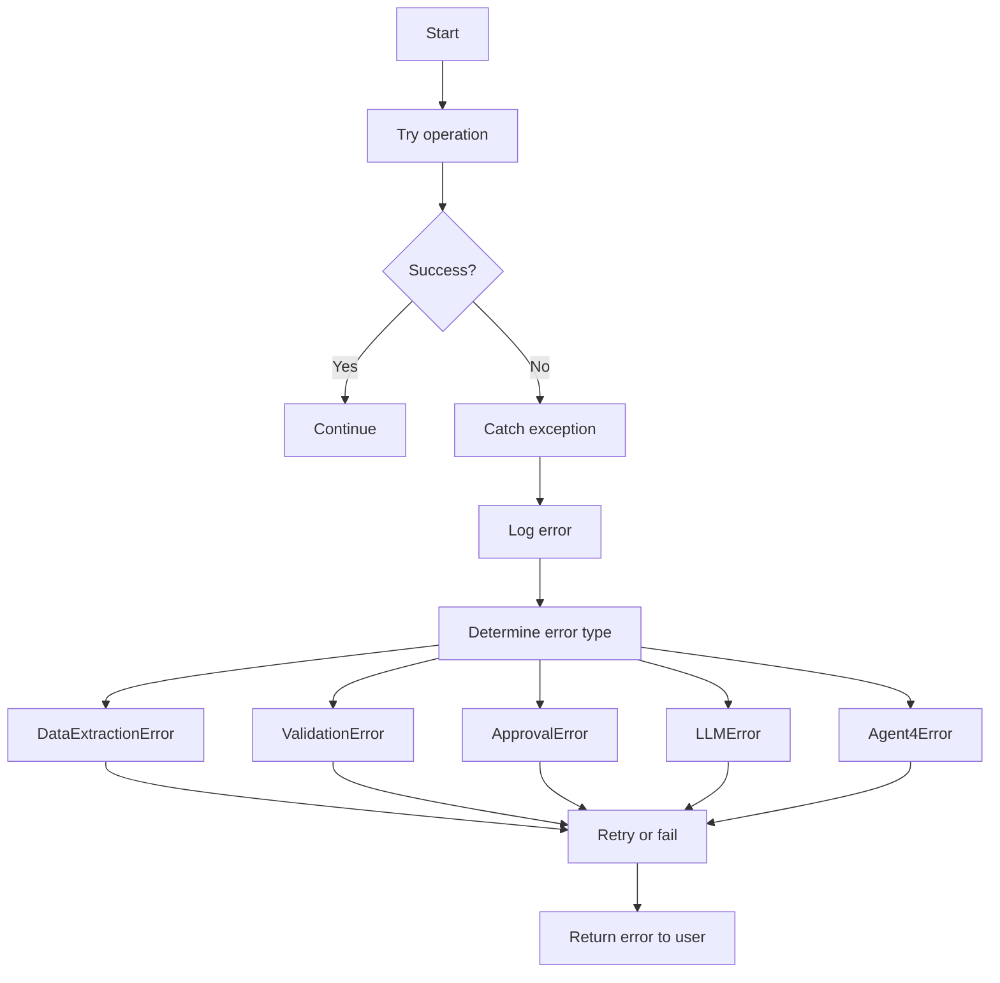

---

## 13. Integration with Existing Pipeline Diagram

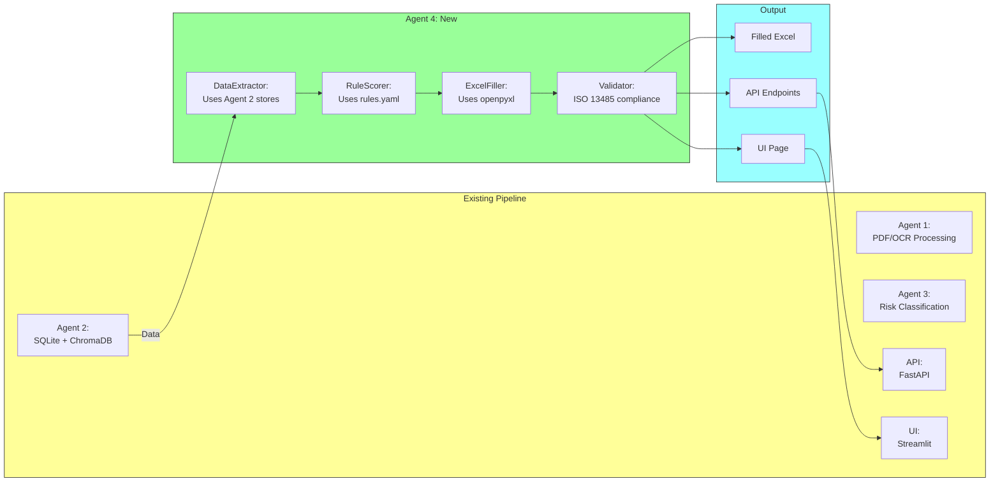

---

## 14. State Transition Diagram

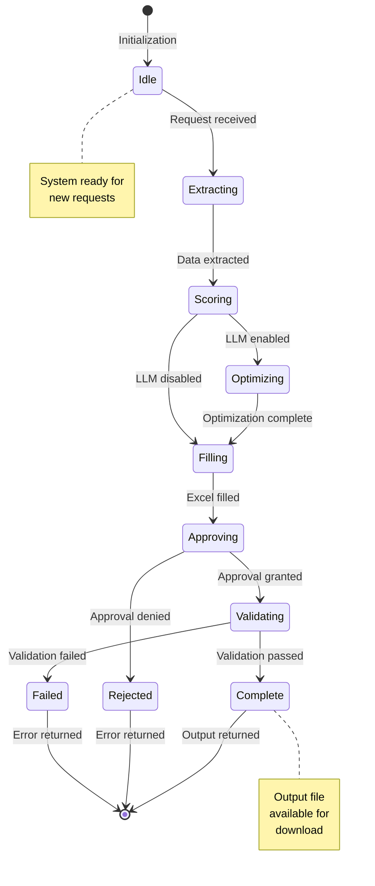

---

## 15. Class Diagram

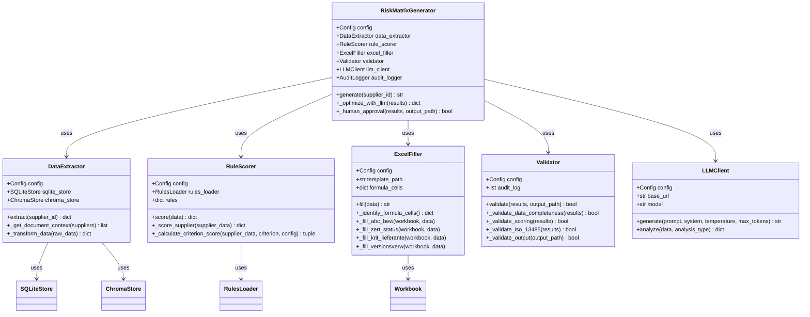

---

## Summary

This document provides **15 different diagrams** covering:
1. System architecture
2. Data flow
3. Workflow sequence
4. Component interactions
5. Excel filling process
6. Data transformation
7. Scoring process
8. Validation process
9. LLM integration
10. ISO 13485 compliance
11. Error handling
12. Pipeline integration
13. State transitions
14. Class relationships

**All diagrams use Mermaid syntax** which can be:
- Rendered in Markdown viewers (GitHub, VS Code, etc.)
- Copied to Mermaid Live Editor for interactive viewing
- Exported to PNG/SVG using Mermaid tools

**Next Steps:**
1. Review [08_ORCHESTRATION_LAYER.md](./08_ORCHESTRATION_LAYER.md) for LangGraph + LLM details
2. Review [09_VERSION_COMPARISON.md](./09_VERSION_COMPARISON.md) for approach evolution
3. Review [10_IMPLEMENTATION_GUIDE.md](./10_IMPLEMENTATION_GUIDE.md) for setup instructions

---

*Document Version: 1.0.0 | Last Updated: November 2024 | Author: AI Assistant*
